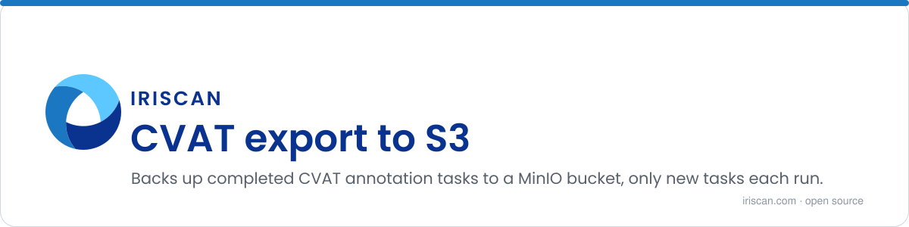

# CVAT export to S3

A small Python script that backs up finished annotation work from CVAT to S3-compatible storage. CVAT (Computer Vision Annotation Tool) is the open-source web tool teams use to draw boxes, polygons and labels on images and video to build training data. This script asks CVAT for every completed task in the projects you name, downloads each one as a dataset archive and uploads it to a MinIO bucket, keeping a CSV of what has already been synced so each run only uploads new tasks. It is meant to run on a schedule, optionally through a WireGuard tunnel when CVAT sits on a private network.

## What it does

- Lists the tasks of the chosen CVAT projects with a given status (`completed` by default) through the official `cvat-sdk`.
- Skips task IDs you list in `CVAT_TASKS_SKIP_IDS` and any task already recorded in `backup.csv` in the bucket.
- Exports each remaining task in the format you choose (`Datumaro 1.0` by default; any CVAT export format works) and polls CVAT until the archive is ready, up to 500 tries 5 seconds apart.
- Uploads the archive to `<MINIO_DIR>/project_<id>/task_<id>.zip` in the bucket and appends a row (project, task, name, status, path) to `backup.csv`.
- Cleans up its temporary `.tmp/` folder when done.

## How to run

Copy `.env.example` to `.env` and fill it in:

| Variable | Meaning |
|---|---|
| `CVAT_URL`, `CVAT_USERNAME`, `CVAT_PASSWORD` | Where CVAT is and how to log in |
| `CVAT_PROJECT_IDS` | Comma-separated project IDs to back up |
| `CVAT_TASKS_SKIP_IDS` | Comma-separated task IDs to leave out |
| `CVAT_EXPORT_FORMAT` | A CVAT export format name, for example `Datumaro 1.0` or `YOLO 1.1` |
| `CVAT_TASK_STATUS` | Which tasks to take: `new`, `in progress`, `rejected` or `completed` |
| `MINIO_URL`, `MINIO_ACCESS_KEY`, `MINIO_SECRET_KEY`, `MINIO_SECURE` | S3 endpoint (`host:port`), credentials and whether to use TLS |
| `MINIO_BUCKET`, `MINIO_DIR` | Bucket name and the folder inside it (`backup` by default) |

Then, with Python 3:

```sh
pip3 install -r requirements.txt
python3 export.py                 # reads .env
python3 export.py --config_env /path/to/other.env
```

To run it in Docker through a WireGuard VPN, put your tunnel config in `wg0.conf` next to `.env` and build the image. The container brings the tunnel up with `wg-quick up wg0` and then runs the script with `conf/.env`:

```sh
docker build -t cvat_export .
docker run --cap-add=NET_ADMIN \
  -v ./wg0.conf:/etc/wireguard/wg0.conf \
  -v ./.env:/app/conf/.env \
  --sysctl="net.ipv4.conf.all.src_valid_mark=1" \
  -it --rm cvat_export
```

`NET_ADMIN` and the sysctl are needed by WireGuard, not by the script itself.

## Related repositories

- [cvat_exporter](https://github.com/biometric-technologies/cvat_exporter): simpler script that downloads one project's annotations in YOLO format to the local disk.

## License

License: not yet specified.

## Contact

info@iriscan.net, https://www.iriscan.com
